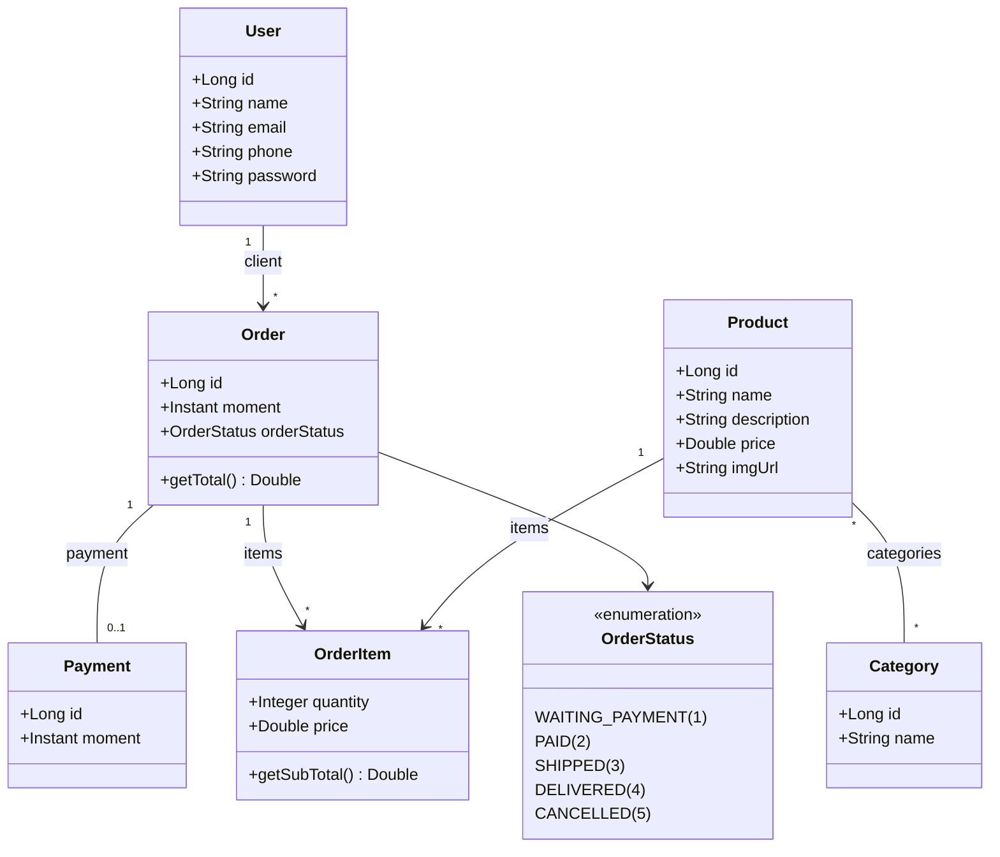

# Workshop Spring Boot & JPA / Hibernate


API RESTful de um sistema de pedidos (e-commerce) desenvolvida com **Spring Boot** e **Spring Data JPA / Hibernate**, construída durante o workshop de Web Services do curso de Java do **Prof. Nélio Alves (DevSuperior)**.

O projeto aplica arquitetura em camadas, mapeamento objeto-relacional completo (associações `1:1`, `1:N`, `N:N` e chave primária composta), perfis de ambiente (`test` e `dev`), *database seeding* automático e tratamento personalizado de exceções HTTP.

---

## Sumário

- [Tecnologias Utilizadas](#-tecnologias-utilizadas)
- [Arquitetura e Estrutura do Projeto](#-arquitetura-e-estrutura-do-projeto)
- [Modelo de Domínio](#-modelo-de-domínio)
- [Endpoints da API](#-endpoints-da-api)
- [Como Executar](#-como-executar)
- [Autor e Créditos](#-autor-e-créditos)

---

## Tecnologias Utilizadas

- **Java 25**
- **Spring Boot 4.1.2**
  - `spring-boot-starter-webmvc` — Construção da API RESTful
  - `spring-boot-starter-data-jpa` — Persistência de dados com JPA / Hibernate
  - `spring-boot-h2console` — Console web do banco H2
- **H2 Database** — Banco de dados em memória para o perfil de testes (`test`)
- **PostgreSQL** — Banco de dados relacional para o perfil de desenvolvimento (`dev`)
- **Maven** (com Maven Wrapper `mvnw` incluso)

---

## Arquitetura e Estrutura do Projeto

O sistema segue uma arquitetura em camadas bem definida (**Resource / Controller → Service → Repository → Entities**):

```text
src/main/java/org/example/demo/
├── DemoSpringApplication.java          # Classe principal da aplicação
├── config/
│   └── TestConfig.java                 # Seeding do banco H2 no perfil "test"
├── entities/                           # Entidades JPA do domínio
│   ├── Category.java
│   ├── Order.java
│   ├── OrderItem.java
│   ├── Payment.java
│   ├── Product.java
│   ├── User.java
│   ├── enums/
│   │   └── OrderStatus.java            # Enum com controle explícito de código numérico
│   └── pk/
│       └── OrderItemPK.java            # Chave primária composta (@Embeddable)
├── repositories/                       # Interfaces Spring Data JPA
│   ├── CategoryRepository.java
│   ├── OrderItemRepository.java
│   ├── OrderRepository.java
│   ├── ProductRepository.java
│   └── UserRepository.java
├── resources/                          # Controladores REST e handlers HTTP
│   ├── CategoryResource.java
│   ├── OrderResource.java
│   ├── ProductResource.java
│   ├── UserResource.java
│   └── exceptions/
│       ├── ResourceExceptionHandler.java
│       └── StandardError.java
└── services/                           # Camada de regras de negócio
    ├── CategoryService.java
    ├── OrderService.java
    ├── ProductService.java
    ├── UserService.java
    └── exceptions/
        ├── DatabaseException.java
        └── ResourceNotFoundException.java
```

---

## Modelo de Domínio

O diagrama abaixo representa as entidades mapeadas no banco (`tb_user`, `tb_order`, `tb_payment`, `tb_product`, `tb_category`, `tb_product_category` e `tb_order_item`) e seus relacionamentos:



---

## Endpoints da API

Por padrão, a aplicação roda em `http://localhost:8080`.

### Usuários (`/users`)

| Método | Rota | Status de Sucesso | Descrição |
| :--- | :--- | :--- | :--- |
| `GET` | `/users` | `200 OK` | Lista todos os usuários |
| `GET` | `/users/{id}` | `200 OK` | Busca um usuário por ID (`404` se não existir) |
| `POST` | `/users` | `201 Created` | Cadastra um novo usuário |
| `PUT` | `/users/{id}` | `200 OK` | Atualiza `name`, `email` e `phone` de um usuário (`404` se não existir) |
| `DELETE` | `/users/{id}` | `204 No Content` | Remove um usuário (`400` em caso de violação de integridade referencial) |

<details>
<summary><strong>Exemplo de requisição <code>POST /users</code></strong></summary>

```json
{
  "name": "Carlos Silva",
  "email": "carlos@gmail.com",
  "phone": "11999999999",
  "password": "123456"
}
```
</details>

### Pedidos (`/orders`)

| Método | Rota | Status de Sucesso | Descrição |
| :--- | :--- | :--- | :--- |
| `GET` | `/orders` | `200 OK` | Lista todos os pedidos (inclui cliente, itens, subtotais, pagamento e total) |
| `GET` | `/orders/{id}` | `200 OK` | Busca um pedido por ID |

### Produtos (`/products`)

| Método | Rota | Status de Sucesso | Descrição |
| :--- | :--- | :--- | :--- |
| `GET` | `/products` | `200 OK` | Lista todos os produtos e suas categorias |
| `GET` | `/products/{id}` | `200 OK` | Busca um produto por ID |

### Categorias (`/categories`)

| Método | Rota | Status de Sucesso | Descrição |
| :--- | :--- | :--- | :--- |
| `GET` | `/categories` | `200 OK` | Lista todas as categorias |
| `GET` | `/categories/{id}` | `200 OK` | Busca uma categoria por ID |

### Tratamento de Erros (`StandardError`)

Exceções de negócio e integridade de banco são interceptadas por `ResourceExceptionHandler` (`@ControllerAdvice`), retornando um JSON padronizado:

```json
{
  "timestamp": "2026-11-03T22:00:00Z",
  "status": 404,
  "error": "Resource not found",
  "message": "Resource not found with id 99",
  "path": "/users/99"
}
```

---

## Como Executar

### Pré-requisitos

- **JDK 25** instalado e configurado no `PATH`
- **PostgreSQL** *(opcional — necessário apenas para rodar no perfil `dev`)*

### 1. Clonar o repositório

```bash
git clone https://github.com/Nicolas1548/workshop-springboot-jpa.git
cd workshop-springboot-jpa
```

### 2. Executar no Perfil `test` (Recomendado para teste rápido — H2 em memória)

O perfil `test` sobe um banco H2 em memória e executa automaticamente a carga inicial de dados (`TestConfig` com usuários, categorias, produtos, pedidos e pagamentos):

**Linux / macOS:**
```bash
./mvnw spring-boot:run -Dspring-boot.run.profiles=test
```

**Windows (PowerShell / CMD):**
```powershell
.\mvnw.cmd spring-boot:run "-Dspring-boot.run.profiles=test"
```

Para inspecionar as tabelas no **H2 Console**, acesse `http://localhost:8080/h2-console` com os dados:
- **JDBC URL:** `jdbc:h2:mem:testdb`
- **User Name:** `sa`
- **Password:** *(deixe em branco)*

### 3. Executar no Perfil `dev` (PostgreSQL)

Por padrão, `src/main/resources/application.properties` está configurado com `spring.profiles.active=dev`.

1. Crie um banco de dados chamado `springboot_` no seu PostgreSQL local (porta `5432`).
2. Ajuste `spring.datasource.username` e `spring.datasource.password` em `src/main/resources/application-dev.properties` conforme o seu ambiente.
3. Execute a aplicação:

```bash
./mvnw spring-boot:run
```

---

## Autor e Créditos

- **Autor:** Nicolas Gabriel — [@Nicolas1548](https://github.com/Nicolas1548)
- **Créditos:** Projeto baseado no workshop *Web Services com Spring Boot e JPA / Hibernate* do curso **Java Completo — Programação Orientada a Objetos + Projetos**, ministrado pelo **Prof. Dr. Nélio Alves** ([DevSuperior](https://github.com/acenelio)).
